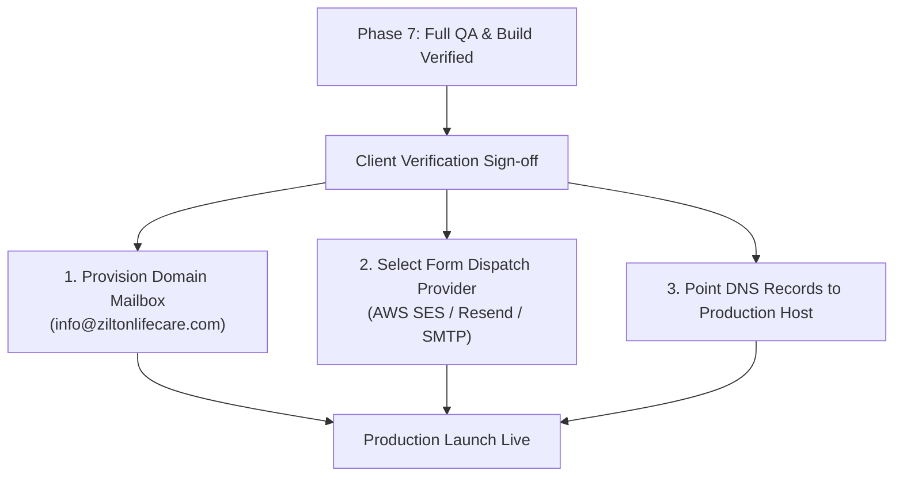

# ZILTON LIFE CARE PRIVATE LIMITED
## Client Verification & Pre-Launch Due Diligence Register

**Document Version:** 1.0.0  
**Audit Milestone:** Phase 7 Website Integration & Production Readiness  
**Target Entity:** ZILTON LIFE CARE PRIVATE LIMITED  
**Classification:** Internal Pre-Launch Compliance

---

### Executive Summary

This register catalogs every company fact, product formulation specification, regulatory assertion, quality assurance statement, and institutional contact point currently presented across the corporate website.

Each item is categorized by its **current representation**, **evidence required from the client**, **verification status** (*Confirmed*, *Pending Evidence*, or *Staged Placeholder*), and whether unresolved status **blocks commercial production launch**.

---

### Verification Matrix

| # | Information / Claim | Current Website Representation | Evidence Required from Client | Status | Blocks Launch? |
| :--- | :--- | :--- | :--- | :--- | :--- |
| **01** | **Registered Entity Name** | `ZILTON LIFE CARE PRIVATE LIMITED` | Certificate of Incorporation issued by Ministry of Corporate Affairs (MCA), India. | **Confirmed** | No |
| **02** | **Registered Office Address** | `LAXMI HOUSING & FINANCE, 67 B, GOPAL MANSION, GURUNANAK ROAD, BANDRA WEST, MUMBAI – 400050, MAHARASHTRA, INDIA` | MCA master data record / electricity bill / rent agreement matching registered address. | **Confirmed** | No |
| **03** | **Official Telephone** | `+91 9819667211` | Written confirmation that this mobile/landline is designated for public business enquiries. | **Confirmed** | No |
| **04** | **WhatsApp Business Status** | Direct link in floating widget pointing to `+91 9819667211` | Confirmation that this number is registered on WhatsApp Business app for institutional chats. | **Pending Evidence** | No (Non-blocking fallback to standard telephone) |
| **05** | **Official Email Address** | Displayed as `info@ziltonlifecare.com` with disclaimer *(Awaiting official domain mailbox provisioning)* | Proof of domain ownership and active mailbox provisioning on Google Workspace / Microsoft 365. | **Pending Evidence** | **YES (Production Blocker)** |
| **06** | **Product Catalogue & Compositions (12 SKUs)** | 9 Critical Care Injections (MEROZIL 1gm/500mg, Ziltaz 4.5gm, Polyzil 5/7.5 lac IU, Fosfozil 4gm, Tigezil 50mg, ZilFCM 500mg, Micasure 50mg), 1 Nutrition IV (Zinctrace IV), 2 Nutrition Sachets (HMB ZIL, Glutashape) | Signed Product Master / DCGI Drug Approval files / Form 25 / Form 28 drug marketing authorizations. | **Confirmed (Portfolio Match)** | No |
| **07** | **Product Packshots & Visuals** | Rendered with high-contrast SVG placeholders marked *"Official Packshot Pending"* | High-resolution photographs (3D renders or studio packshots) of final commercial carton/vial packaging. | **Staged Placeholder** | No (Clean placeholders active) |
| **08** | **Product Storage Conditions** | Explicitly framed as *"Formulation-specific parameters as per approved package insert"*; no universal claims made | Approved Package Inserts / Summary of Product Characteristics (SmPC) for each SKU. | **Confirmed (Neutral Wording)** | No |
| **09** | **Contract Manufacturing Governance** | Website clearly distinguishes corporate marketing entity from third-party contract manufacturing plants | Copy of Loan License / Third-Party Manufacturing Agreements with qualified cGMP plants. | **Pending Evidence** | No (Safely framed on site) |
| **10** | **Partner cGMP / Schedule M Compliance** | Website references manufacturing partners operating under audited cGMP and Schedule M standards | Valid Schedule M and WHO-GMP certificates of the contract manufacturing facilities. | **Pending Evidence** | No (Attribute to partners, not direct self-claim) |
| **11** | **Analytical Quality Documentation (CoA / BMR)** | States that batch Certificates of Analysis and BMR summaries are furnished upon institutional due-diligence request | Sample Certificate of Analysis (CoA) for at least one commercial batch of an injectable SKU. | **Pending Evidence** | No (Framed as on-demand institutional disclosure) |
| **12** | **Cold Chain & Thermal Transport (GDP)** | Details formulation-specific cold-chain (2°C–8°C for sensitive injectables) vs. Controlled Room Temperature (<25°C) | Validated transport SOP or temperature logging agreement with cold-chain logistics providers. | **Pending Evidence** | No (Safely described as standard procedure) |
| **13** | **Batch Traceability Process** | Visual depicts 4-stage documentation flow (Product Master &rarr; Lot Code &rarr; CoA/BMR &rarr; Delivery Manifest); disclaims automated SaaS claims | Physical sample of invoice/consignment note showing batch number and expiry date printing. | **Confirmed (Neutral Flow)** | No |
| **14** | **Business Operating Hours** | `Monday to Saturday: 09:30 AM – 06:30 PM IST` (Closed Sundays & National Holidays) | Confirmation from executive management of desk operational hours. | **Confirmed** | No |
| **15** | **Contact Form Dispatch Backend** | Form currently operates in verified staging/simulated mode generating reference IDs (`ZLC-...`) | Designated recipient email address and preferred SMTP/API dispatch service (e.g., AWS SES, Resend, or SendGrid). | **Pending Evidence** | **YES (Production Blocker)** |
| **16** | **Domain Ownership & SSL Certificate** | Canonical domain targeted at `https://ziltonlifecare.com` | DNS records configured (A/CNAME records) and SSL certificate active on production hosting environment. | **Pending Evidence** | **YES (Production Blocker)** |

---

### Critical Path to Live Launch

#### Immediate Client Action Items:
1. **Corporate Mailbox Provisioning:** Activate `info@ziltonlifecare.com` or designate alternate inbox (`sales@ziltonlifecare.com`).
2. **Form Dispatch Destination:** Specify who receives website inquiries and approve backend credentials.
3. **Official Packaging Imagery:** Provide product packshots as available to replace temporary vector placeholders.

